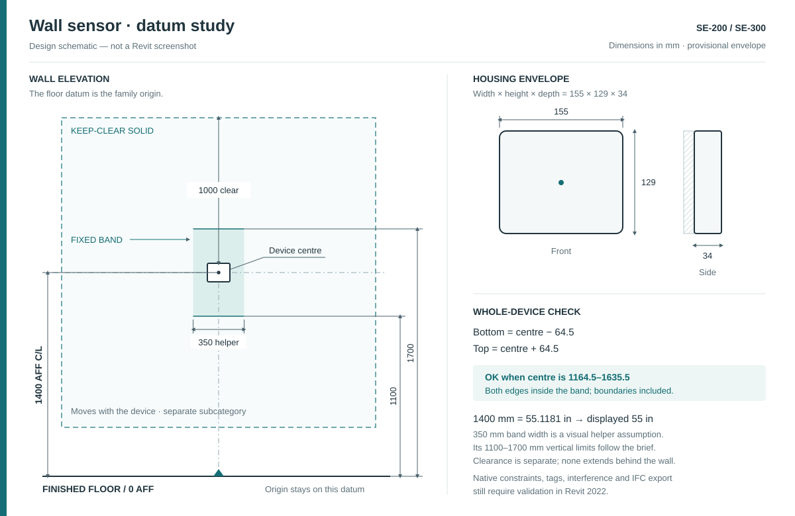

# Wall sensor · Revit 2022

A face-based indoor-air sensor study: a small housing, a mounting-height parameter, a fixed installation band, and a clearance solid.

**Status: source prototype.** The add-in is compiled against the Revit 2022 API and the numerical contract tests pass. It has not run inside Revit 2022. There are no validated `.rfa` / `.rvt` deliverables in this repository yet. The tag requires a manually prepared seed. This is not a completed manufacturer BIM library.



## What the implementation covers

- SE-200 and SE-300 in one face-based Generic Model family.
- 155 W × 129 H × 34 D mm rounded housing, built from native extrusions.
- Instance `Mounting Height`, default 1400 mm, and shared calculated `Band Status`.
- A fixed 1100–1700 mm band. Both device edges must be inside it.
- A 1000 mm keep-clear solid on `WS_KeepClear`, with a visibility switch.
- Symbolic plan curves, a sample wall with door/grille proxies, boundary specimens and a schedule.
- `IfcExportAs = IfcSensor`, with export verification still required.

The key datum choice: **place the family's origin at the finished floor**, then change `Mounting Height`. The housing moves; the band stays at the datum. An arbitrary wall click does not establish AFF. The sample builder sets and checks the datum explicitly. A general drop-at-any-height workflow still needs a placement solution and native testing.

For the provisional 129 mm device height, centre heights **1164.5–1635.5 mm inclusive** are valid. A centre-only check would incorrectly accept 1100 mm and 1700 mm.

## Build and test

Windows, .NET Framework 4.8, PowerShell and Revit 2022 API references are required. No additional SDK or package manager is needed when the Framework compiler is present.

```powershell
./scripts/build.ps1 -RevitInstallPath 'C:\Program Files\Autodesk\Revit 2022'
./scripts/test.ps1
```

For compile-only work without Revit, use `./scripts/build.ps1 -UseNuGetReferences`. This downloads a pinned 7 MB third-party reference package. It does not install Revit or enable native file creation. Autodesk assemblies are not included in this repository.

## Generate native files

1. Use a valid **Revit 2022** installation and its metric family templates. A later Revit release cannot save back to 2022.
2. Create the dynamic tag once using [tag-seed.md](docs/tag-seed.md) and the supplied [shared parameter file](parameters/shared-parameters.txt).
3. Build, run `./scripts/install.ps1`, then restart Revit 2022.
4. From **Add-Ins > External Tools > Build Wall Sensor Demo**, select the unhosted Generic Model template, face-based Generic Model template, tag seed and output location.
5. Open the new output folder. Review `acceptance.csv`, then complete the native checks in [acceptance.md](docs/acceptance.md).

The intended native outputs are `WS_WallSensor.rfa`, `WS_SensorTag.rfa` and the sample `.rvt`. A separate source-components folder retains the small housing/proxy source families. The sensor embeds its housing and must be tested without that folder before release. The size limit is treated strictly as **under 1,000,000 bytes**.

The build command uses a new output directory and does not overwrite existing families. **Check Wall Sensor Demo** can inspect an open sample again; temporary flex tests are rolled back.

## Verification and open decisions

Current local evidence: Revit 2022 API compilation and **35 passing numeric/identity checks**. Those tests do not execute Revit formulas or validate geometry. Native file size, tag layout, plan display, interference and IFC are pending. A geometry intersection test is not a Revit Interference Check report.

Category, mounting plate, final parameter table, reference IFCs and the direction of the 1000 mm clearance still need confirmation. This study interprets the envelope as 155 mm wide / 129 mm high and keeps clearance outside the wall. The door and grille are coordination proxies, not production families.

- [Design decisions and parameter contract](docs/design.md)
- [Native acceptance cases and expected boundary values](docs/acceptance.md)
- [API sources and dependency notes](docs/references.md)

MIT for this repository's source and documentation. Autodesk software, templates and third-party dependencies retain their own terms.
