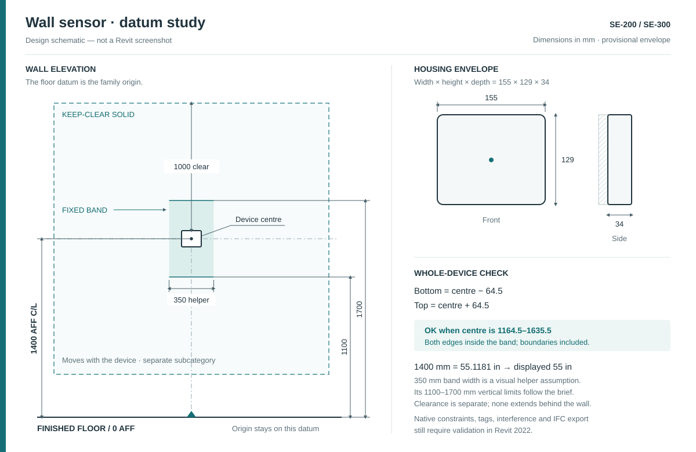

# Design notes

This is a Revit 2022 implementation candidate. The code has not yet been exercised inside Revit. The diagram is a design drawing, not a screenshot or proof of a generated family.



## Assumptions

| Item | Current choice | Reason / remaining decision |
|---|---|---|
| Envelope | 155 mm wide × 129 mm high × 34 mm deep | The brief gives three dimensions without a named axis order. Confirm before delivery. |
| Housing corners | 8 mm radius | Placeholder geometry only; no imported CAD. |
| Category | Generic Models | Suitable starting point for a face-hosted coordination object. Client category is still open. |
| Types | SE-200, SE-300 | Same provisional housing; type marks match the type names. No invented model-specific dimensions. |
| Plate | No separate plate geometry | Footprint is not supplied. |
| Clearance | 1000 mm left, right, above, below, and outward from the front | Wall-normal extent is 0–1034 mm from the face; no clearance behind the wall. This interpretation needs client approval. |
| Mounting band width | 350 mm, centred on the device axis | A visual helper assumption, independent of the 2155 mm wide clearance. Only its 1100–1700 mm vertical limits are specified in the brief. |
| Height datum | Finished-floor datum at the family insertion origin | The family cannot infer a finished floor from an arbitrary wall click. |
| IFC | `IfcExportAs = IfcSensor`; `IfcExportType = USERDEFINED` | Target IFC4. The actual exported entity and helper geometry need checking. |

## Datum and motion

The parent is made from a face-based template. Its local X axis runs along the wall, local Y points up, and local Z points away from the wall. The insertion origin is the finished-floor datum on the host face.

A small unhosted housing family is embedded in the parent. A labelled dimension positions its centre at `Mounting Height`. The rounded housing, clearance volume and plan symbol move together. The mounting band belongs to the parent and stays at local Y = 1100–1700 mm. Its provisional width is 350 mm (local X = −175 to +175 mm); this narrow visual helper does not represent the clearance envelope.

This makes the formula and geometry use the same datum. It also creates an important placement constraint: changing `Mounting Height` is supported; moving the entire instance upward moves the datum as well. For example, placing the origin 200 mm above the finished floor and setting 1400 mm gives an actual centre at 1600 mm. A family formula does not detect that mistake. The sample builder must align the origin to the finished-floor level and the verifier must measure world coordinates. Manual placements require the same alignment.

The declared origin should be indicated clearly in the family and instructions. Test rotated walls and mirrored instances before treating it as a general drop-on-wall asset. Sloped faces and floor-hosted placement are outside the current candidate scope.

## Band calculation

For a 129 mm high body at centre height `H`, its lower and upper edges are `H − 64.5` and `H + 64.5` mm. Both edges must be inside the inclusive 1100–1700 mm interval. The valid centre interval is therefore **1164.5–1635.5 mm**.

The shared text parameter uses a family formula:

```text
if(or((Mounting Height - Device Height / 2) < Band Minimum,
      (Mounting Height + Device Height / 2) > Band Maximum),
   "OUT OF BAND", "OK")
```

The test executable checks the corresponding numeric contract; it cannot validate Revit's formula parser or the geometry constraint. The native run must test those separately.

`Mounting Height` and `Band Status` use stable shared-parameter identities so the model, tag seed and schedule can reference the same fields:

| Name | GUID | Intended storage |
|---|---|---|
| Mounting Height | `683c7d22-6dd7-4f63-b753-f38b50c043f7` | Instance length |
| Band Status | `ab717f7f-bc7e-4b66-a31d-ff138d3c3125` | Instance text, calculated |

## Geometry and display

The housing uses a short rounded extrusion. There are no meshes, imported models, internal electronics or manufacturer details. Both types share the same housing in this candidate.

| Subcategory | Content | Control |
|---|---|---|
| `WS_Device` | Physical housing solid | Model visibility |
| `WS_KeepClear` | Coordination solid | `Show Keep Clear` |
| `WS_MountingBand` | Thin band at the host face | `Show Mounting Band` |
| `WS_PlanSymbol` | Symbolic curves on the local XZ plane | Plan/RCP view behavior, to verify |

The clearance is intentionally a solid, not a void, mesh or annotation. Its nominal envelope is 2155 × 2129 × 1034 mm. Native interference behavior cannot be inferred from its appearance: test the clash command with the visibility switch on and off. An API solid intersection is a useful separate check, but it is not equivalent to Revit's Interference Check result.

The band and clearance are helpers, not physical sensor material. Decide how they should appear in IFC exports. A correct `IfcSensor` entity name alone does not prove that its representation excludes these helpers. Export visibility, category filters and exporter settings require an explicit acceptance test.

## Annotation

The tag should show Type Mark, followed by the same shared length twice with independent unit formatting. Use whole millimetres for the first label and whole inches for the second, with appropriate literal text and suffixes. At 1400 mm, the unrounded height is 55.1181 in, displayed as 55 in. Do not replace 1400 mm with 1397 mm to make the rounded label exact.

The public Revit 2022 API does not provide a supported method to create an editable family label. A native tag seed must therefore be prepared in the Revit family editor and passed to the builder. A static text note that merely looks like a tag is not a substitute. The seed needs testing after type changes and instance height changes.

## Limits of current evidence

Compilation establishes API compatibility at the referenced assembly level. Unit tests establish the numeric acceptance interval and unit conversion contract. Neither establishes working native files.

Before this can be supplied as the client's completed family, Revit 2022 must generate and reopen the native files, flex both types, verify placement and symbols, run interference checks, inspect tag labels, export IFC4, and measure the final sensor file size. See [acceptance.md](acceptance.md).
